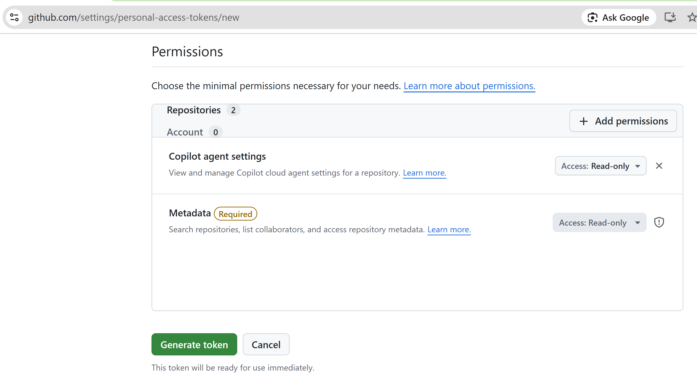
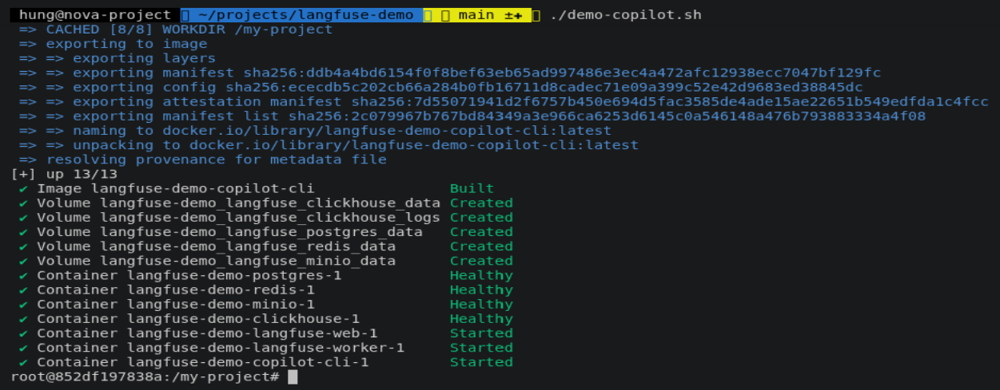
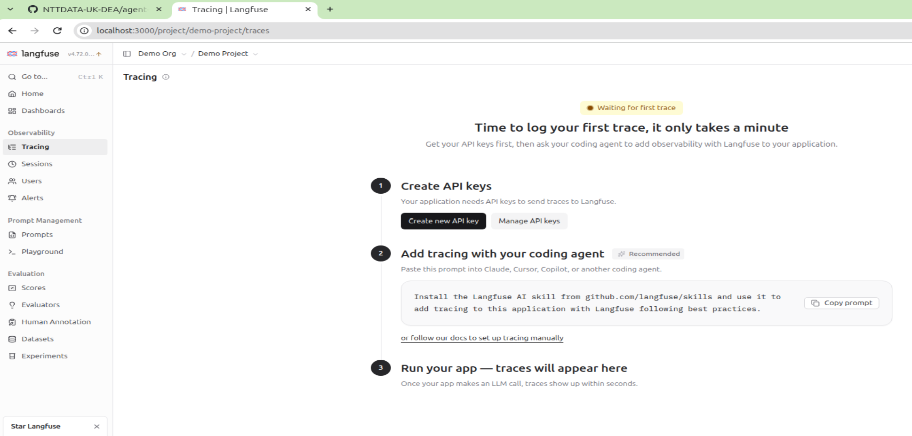
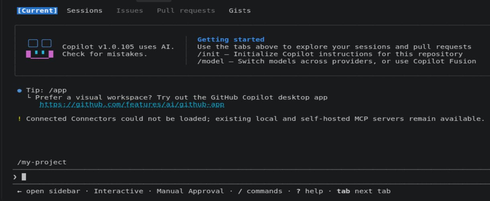
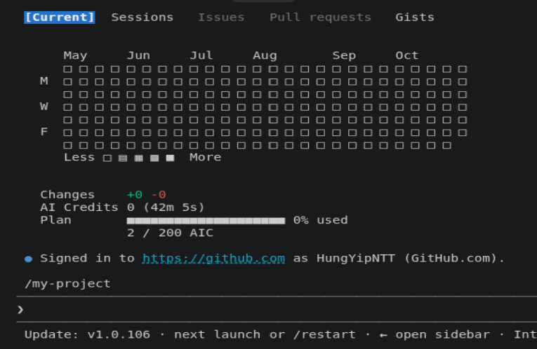
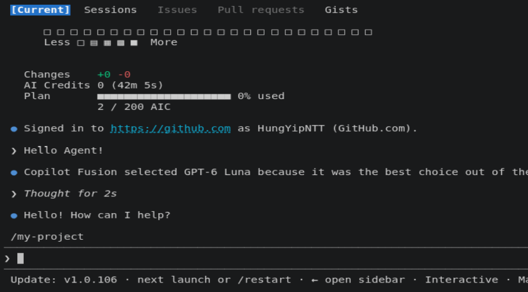
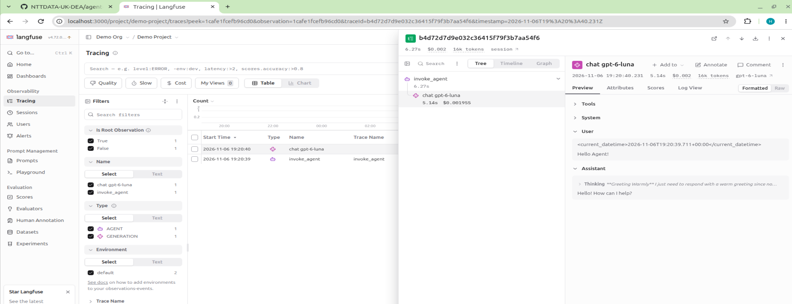
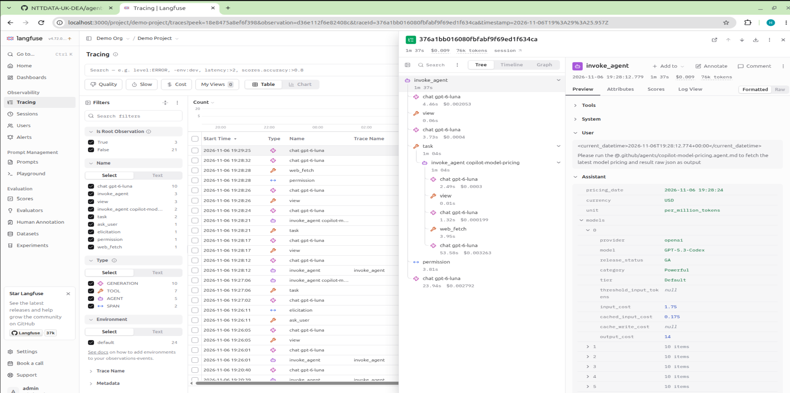
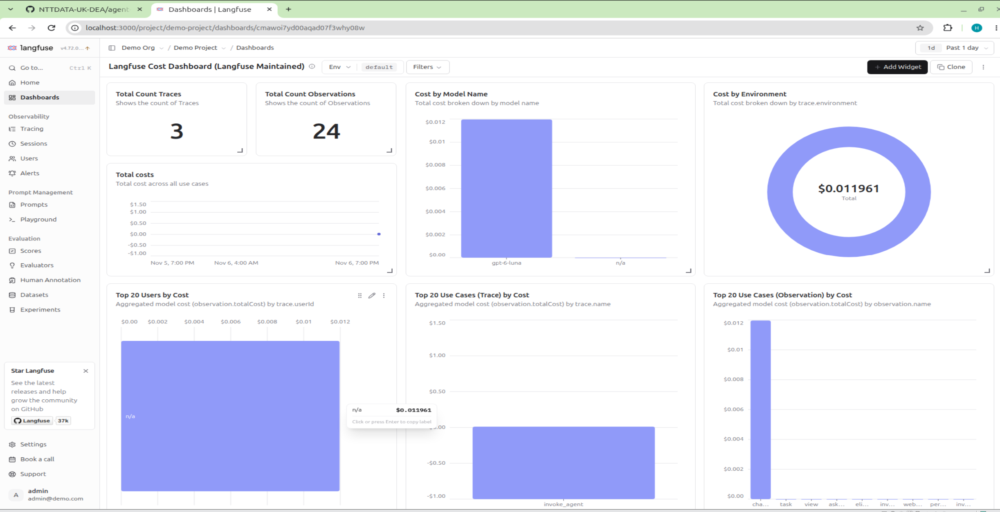

# Copilot CLI and self-hosting Langfuse Demo

## About this demo

This demo illustrates how Copilot CLI pushes OpenTelemetry metrics and traces to a local [self-hosting Langfuse server](https://langfuse.com/self-hosting).

[Langfuse](https://langfuse.com/docs/observability/get-started) is an open-source AI observability platform for Large Language Model (LLM) and AI agent applications. It comes with a built-in dashboard and trace viewer for monitoring, and it can also be deployed locally.

Since Copilot CLI natively support OTLP, therefore we only need to assign the OTEL environment variables to enable the OpenTelemetry reporting.

```yaml
    environment:
      COPILOT_OTEL_ENABLED: true
      OTEL_EXPORTER_OTLP_ENDPOINT: http://langfuse-web:3000/api/public/otel
      #OTEL_EXPORTER_OTLP_HEADERS: Authorization=Basic <<base64-$LANGFUSE_PUBLIC_KEY:$LANGFUSE_SECRET_KEY>>,x-langfuse-ingestion-version=4"
      # opt-in: include prompts, responses, and tool arguments
      OTEL_INSTRUMENTATION_GENAI_CAPTURE_MESSAGE_CONTENT: true
      COPILOT_MODEL: gpt-6-luna
      GH_TOKEN: ${GH_TOKEN:-}
```

## How to run this demo

1. Clone this GitHub repo. Docker must be installed on your machine.

   ```
   git clone https://github.com/kwonghung-YIP/langfuse-demo
   ```

2. Create your GitHub Fine-grained Personal Access Token, the token requires the "Read access to user copilot requests" permission. ([GitHub > Profile Settings > Developer Settings > Personal access tokens > Fine-grained tokens > "Generate new token"](https://github.com/settings/personal-access-tokens)).

   

3. Paste the token into the **`.env`** file in the repo root folder, and create the **`GH_TOKEN`** environment variable.

   ```
   GH_TOKEN=<<paste_your_token_here>>
   ...
   ```

4. Run [**`./demo-copilot.sh`**](../demo-copilot.sh). It:

   - starts the [docker-compose.yml](../docker-compose.yml) stack with the copilot profile (the first run may take some time to download the images),
   - builds and starts the Copilot CLI image,
   - starts the self-hosted Langfuse stack, [langfuse-compose.yml](../langfuse-compose.yml),
   - attaches to the Copilot CLI container.

   ```
   docker compose \
   --profile copilot \
   --env-file .env --env-file demo.env \
   up \
   --build --detach --remove-orphans

   docker compose \
   exec -it copilot-cli \
   bash -c "source setup-copilot-cli.sh && exec bash"
   ```

   After `./demo-copilot.sh` completes, your terminal should be attached to the Copilot CLI container.

   

5. Wait until the Langfuse stack has started, then open the Langfuse console at [http://localhost:3000](http://localhost:3000) and log in with the default user account **admin@demo.com / abcd1234**.

   

6. Go back to the Copilot CLI container and run [**`setup-copilot-cli.sh`**](../copilot-cli/setup-copilot-cli.sh) to complete the setup.

7. Run **`copilot`** to start Copilot CLI, and trust the **`/my-project`** workspace.

   

8. With the Personal Access Token defined in the **`.env`** file, you should be able to log into Copilot.

   

9. Say hello to the agent and find the traces in the Langfuse console.

   

   

10. Run the [copilot-model-pricing](../project-settings/copilot/.github/agents/copilot-model-pricing.agent.md) sub-agent in the **`/my-project`** workspace and check the traces.

   

   

11. Langfuse also comes with a built-in token usage and cost dashboard.

   

12. Run [**`./clear-up.sh`**](./clear-up.sh) to clean up the Docker stack.

## References

- [Self Hosting Langfuse with Docker Compose](https://langfuse.com/self-hosting/deployment/docker-compose)
- [Langfuse Headless Initialization](https://langfuse.com/self-hosting/administration/headless-initialization)
- [Trace GitHub Copilot With Langfuse](https://langfuse.com/integrations/developer-tools/github-copilot)