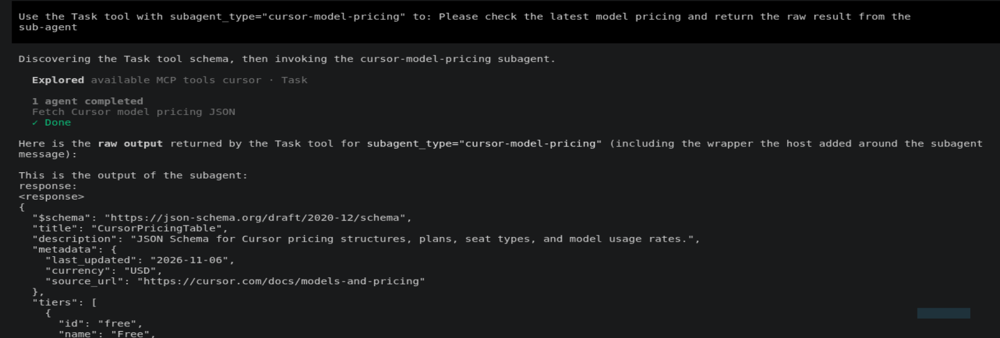
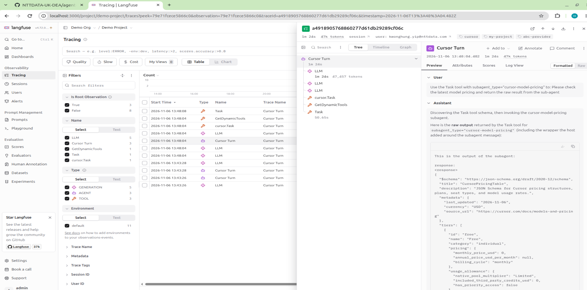

# About this demo

This demo illustrates how's Cursor CLI pushing the OpenTelemetry metrics and traces to (self-hosted langfuse server)[https://langfuse.com/self-hosting] locally without step out the coporated closed dev environment.

langfuse is an open-source AI observability platform for Large Language Model (LLM) and AI agent applications, it comes with built-in dashboard and traces viewer for monitoring, and it also allow deployed locally.

Because Cursor CLI does not natively support OTLP, so langfuse provided a (Cursor Plugin)[https://github.com/langfuse/cursor-observability-plugin] to capture the metrics and traces with the Cursor Hooks and send it to langfuse backend.

## How to run this demo

1. Clone this github repo, and assumed docker is installed into your machine.
```bash
git clone https://github.com/kwonghung-YIP/langfuse-demo

```

2. Create your Cursor API token ([Settings > API Keys > Add...](https://cursor.com/dashboard/api)).


3. Paste the token into the **_repo_root_/.env** file in the repo root folder, and create the **CURSOR_API_KEY** env variable.

```.env
CURSOR_API_KEY=<<paste_your_token_here>>
...
```

4. Run the [**`./demo-cursor.sh`**](../demo-cursor.sh), it:
- starts the [docker-compose.yml](../docker-compose.yml) stack with cursor profile (it takes sometime to download the images for your first run),
- build and start the Cursor CLI image,
- start langfuse self-hosted stack [langfuse-compose.yml](../langfuse-compose.yml),
- attach to the Cursor CLI container,

```bash
#!/bin/bash

docker compose \
  --profile cursor \
  --env-file .env --env-file demo.env \
  up \
  --build --detach --remove-orphans

docker compose \
  exec -it cursor-cli \
  bash
```

- After the `./demo-cursor.sh`, you should you are attached to the Cursor CLI container.


5. Wait until the langfuse stack started, launch the langfuse console [http://localhost:3000](), and login with the default user account **admin@demo.com/abcd1234**


6. Back into the Cursor CLI container, run [**`setup-langfuse-plugin.sh`**](../cursor-cli/setup-langfuse-plugin.sh) to complete the plugin setup.


7. Run **agent** to start Cursor CLI, and trust the */my-proejct** worksapce.


8. With the API token defined in the **.env** file, you should able to login to Cursor.


9. Say hello to the agent and find the traces in langfuse console.


10. Run the [cursor-model-pricing](../project-settings/cursor/.cursor/agents/cursor-model-pricing.md) sub-agent in the **/my-project** workspace and check the traces.





11. Langfuse also comes with the built-in Token usage and cost dashboard.


12. Run the [**`./clear-up.sh`**](../clear-up.sh) to housekeep the docker stack.

## References

- [Self Hosting Langfuse with Docker Compose](https://langfuse.com/self-hosting/deployment/docker-compose)
- [Langfuse Headless Initialization](https://langfuse.com/self-hosting/administration/headless-initialization)
- [Cursor Tracing with Langfuse](https://langfuse.com/integrations/developer-tools/cursor)
- [Langfuse Observability Plugin for Cursor - GitHub Repo](https://github.com/langfuse/cursor-observability-plugin)
