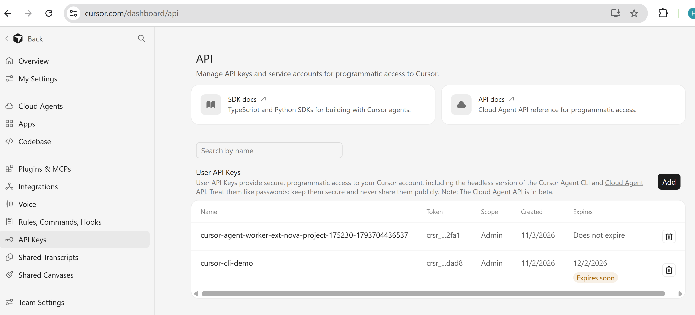
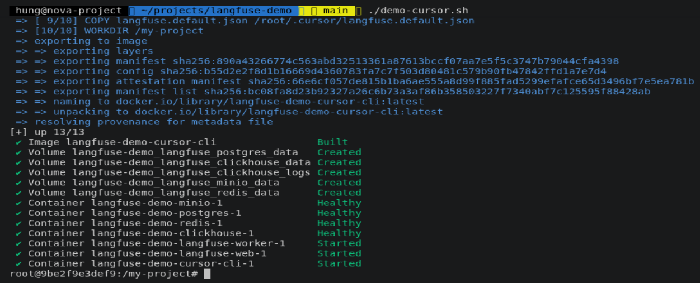
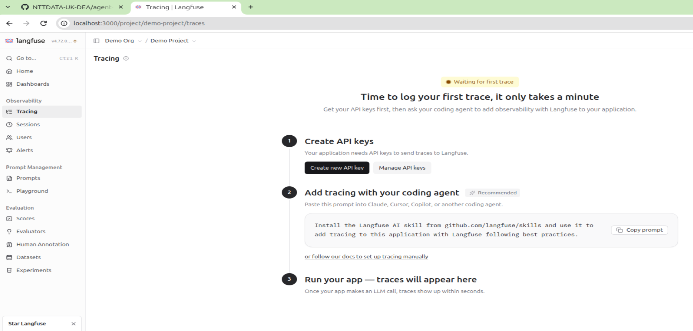
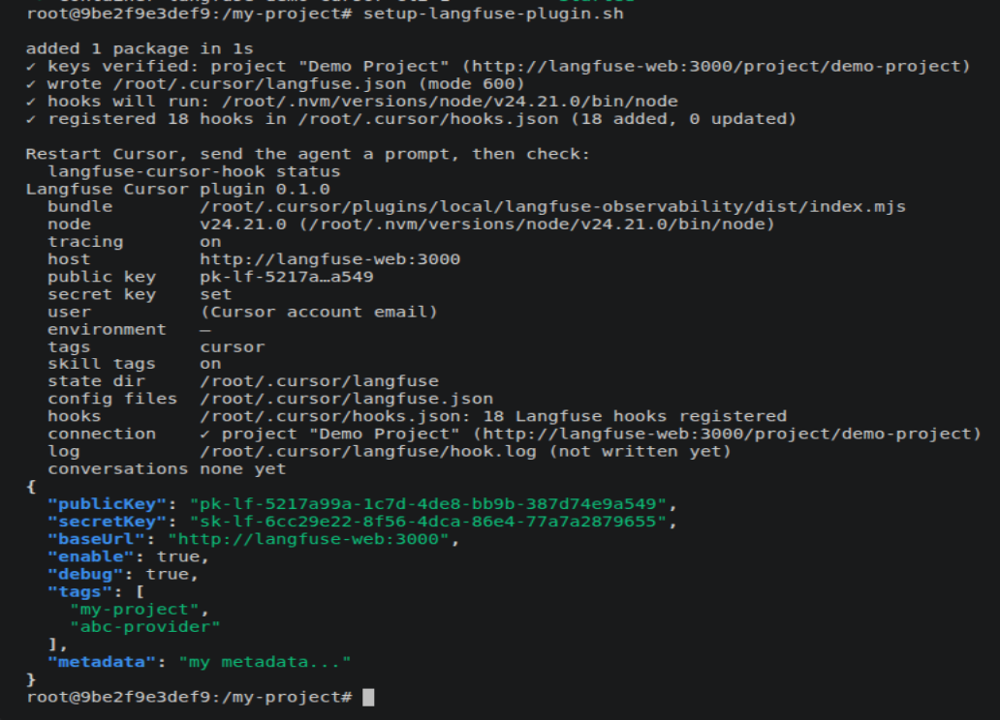
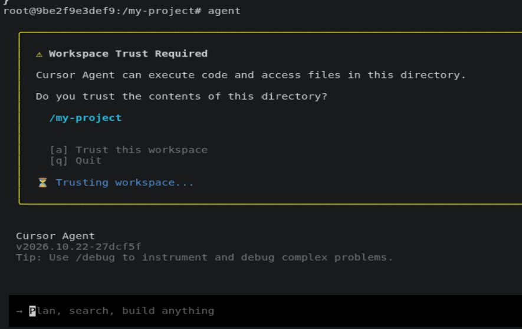
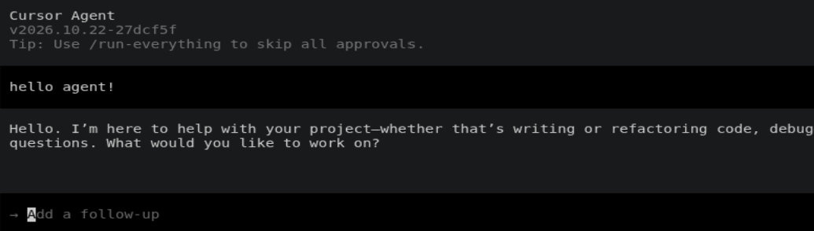
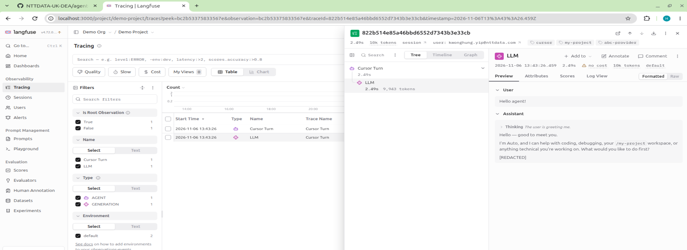
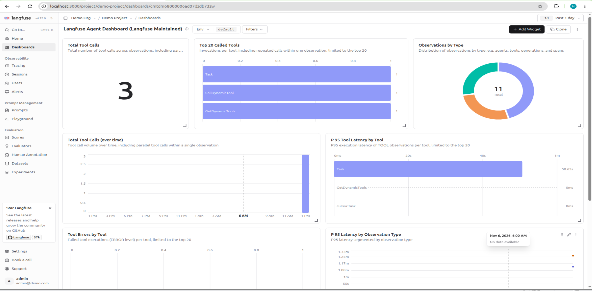

# Cursor CLI and self-hosting Langfuse Demo

## About this demo

This demo illustrates how Cursor CLI pushes OpenTelemetry metrics and traces to a local [self-hosting Langfuse server](https://langfuse.com/self-hosting).

[Langfuse](https://langfuse.com/docs/observability/get-started) is an open-source AI observability platform for Large Language Model (LLM) and AI agent applications. It comes with a built-in dashboard and trace viewer for monitoring, and it can also be deployed locally.

Because Cursor CLI does not natively support OTLP, Langfuse provides a [Cursor plugin](https://github.com/langfuse/cursor-observability-plugin) that captures the metrics and traces with Cursor Hooks and sends them to the Langfuse backend.

## How to run this demo

1. Clone this GitHub repo. Docker must be installed on your machine.

   ```
   git clone https://github.com/kwonghung-YIP/langfuse-demo
   ```

2. Create your Cursor API token ([Settings > API Keys > Add...](https://cursor.com/dashboard/api)).

   [

3. Paste the token into the **`.env`** file in the repo root folder, and create the **`CURSOR_API_KEY`** environment variable.

   ```
   CURSOR_API_KEY=<<paste_your_token_here>>
   ...
   ```

4. Run [**`./demo-cursor.sh`**](../demo-cursor.sh). It:

   - starts the [docker-compose.yml](../docker-compose.yml) stack with the cursor profile (the first run may take some time to download the images),
   - builds and starts the Cursor CLI image,
   - starts the self-hosted Langfuse stack, [langfuse-compose.yml](../langfuse-compose.yml),
   - attaches to the Cursor CLI container.

   ```
   #!/bin/bash

   docker compose \
     --profile cursor \
     --env-file .env --env-file demo.env \
     up \
     --build --detach --remove-orphans

   docker compose \
     exec -it cursor-cli \
     bash
   ```

   After `./demo-cursor.sh` completes, you should be attached to the Cursor CLI container.

   

5. Wait until the Langfuse stack has started, then open the Langfuse console at [http://localhost:3000](http://localhost:3000) and log in with the default user account **admin@demo.com / abcd1234**.

   

6. Go back to the Cursor CLI container and run [**`setup-langfuse-plugin.sh`**](../cursor-cli/setup-langfuse-plugin.sh) to complete the plugin setup.

   [](./cursor/after-setup-langfuse-plugin.sh.png)

7. Run **`agent`** to start Cursor CLI, and trust the **`/my-project`** workspace.

   

8. With the API token defined in the **`.env`** file, you should be able to log in to Cursor.

   

9. Say hello to the agent and find the traces in the Langfuse console.

   

   

10. Run the [cursor-model-pricing](https://github.com/kwonghung-YIP/langfuse-demo/blob/main/project-settings/cursor/.cursor/agents/cursor-model-pricing.md) sub-agent in the **`/my-project`** workspace and check the traces.

    

    

11. Langfuse also comes with a built-in token usage and cost dashboard.

    

12. Run [**`./clear-up.sh`**](./clear-up.sh) to clean up the Docker stack.

## References

- [Self Hosting Langfuse with Docker Compose](https://langfuse.com/self-hosting/deployment/docker-compose)
- [Langfuse Headless Initialization](https://langfuse.com/self-hosting/administration/headless-initialization)
- [Cursor Tracing with Langfuse](https://langfuse.com/integrations/developer-tools/cursor)
- [Langfuse Observability Plugin for Cursor - GitHub Repo](https://github.com/langfuse/cursor-observability-plugin)